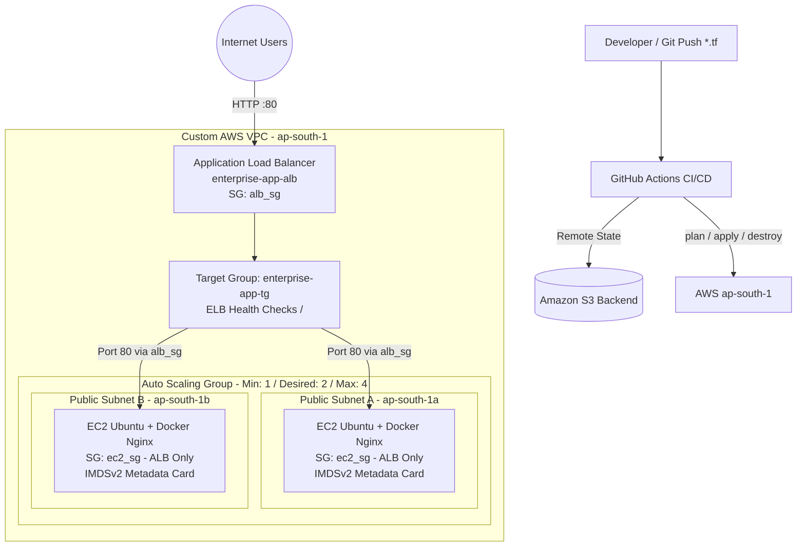
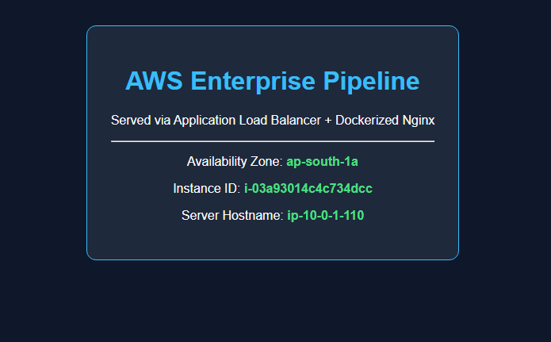
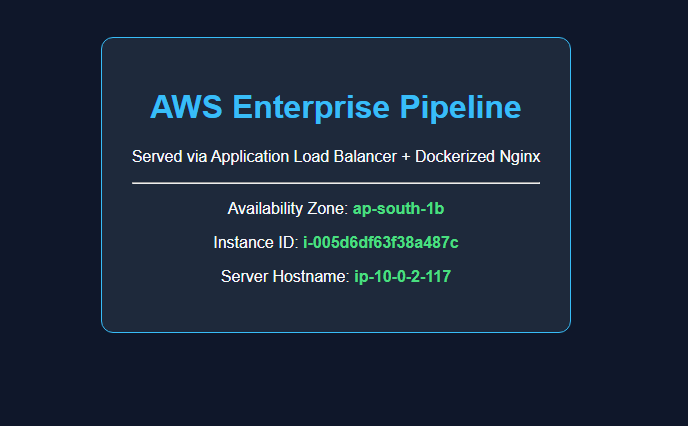
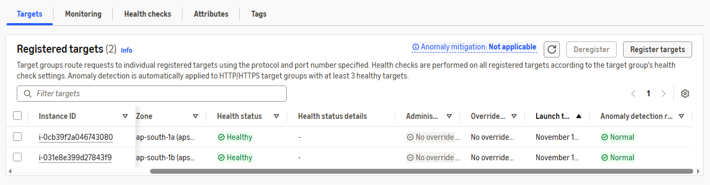
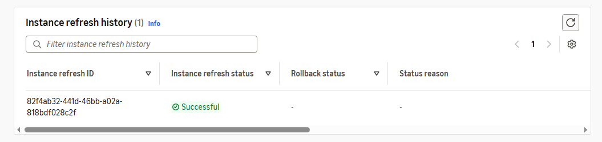
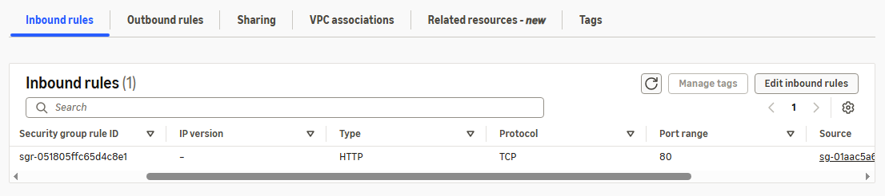
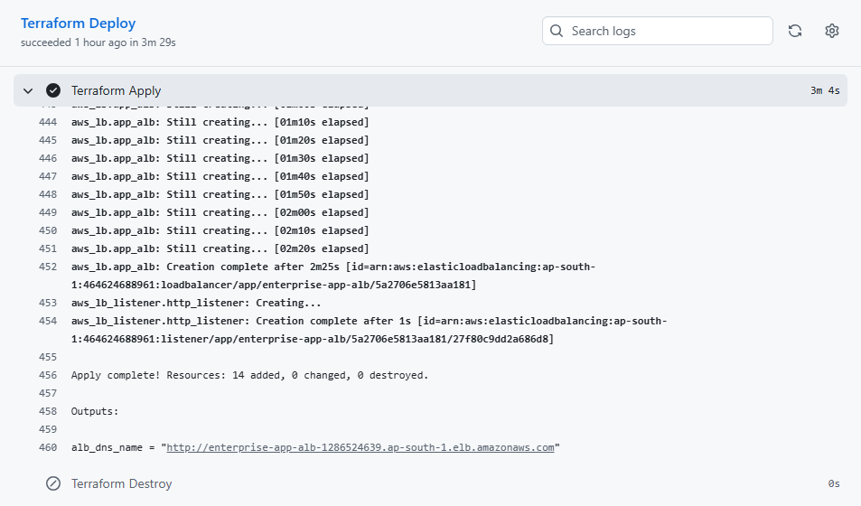

# AWS Load-Balanced Docker Deployment using Terraform & CI/CD
A hands-on, automated AWS web infrastructure provisioned entirely through **Terraform** and managed end-to-end via **GitHub Actions CI/CD**. The architecture deploys containerized Nginx workloads across multiple Availability Zones behind an Application Load Balancer with least-privilege network isolation, zero-downtime rolling updates, and one-click cost-control teardown.

---

## Architecture Overview



---

## Key Engineering Highlights

* **Multi-AZ High Availability:** Provisions a custom VPC spanning `ap-south-1a` and `ap-south-1b` with an Application Load Balancer distributing traffic across an Auto Scaling Group (`min: 1`, `desired: 2`, `max: 4`).
* **Least-Privilege Security Group Chaining:** Application servers (`ec2_sg`) reject all direct internet HTTP traffic (`0.0.0.0/0`) and accept inbound port 80 connections strictly from the Load Balancer's security group (`alb_sg`).
* **Zero-Downtime Rolling Updates:** Configured Auto Scaling Group `instance_refresh` (`strategy = "Rolling"`, `min_healthy_percentage = 50`) pinned to `latest_version`, automatically rotating EC2 instances on Launch Template updates without service interruption.
* **IMDSv2 Dynamic Metadata Injection:** EC2 `user_data` retrieves live Instance ID, Availability Zone, and Hostname via session-token authenticated **IMDSv2** calls and bind-mounts a generated HTML status page read-only (`:ro`) into the Nginx Docker container.
* **Automated CI/CD & FinOps Guardrails:** GitHub Actions automates `init`, `validate`, `plan`, and `apply` using a remote S3 backend, restricts auto-deployments via `paths: [ "**.tf" ]` so documentation updates never wake up AWS resources, and exposes manual `workflow_dispatch` triggers for `plan`, `apply`, and one-click `destroy`.

---

## Repository Structure

```text
aws-enterprise-pipeline/
├── .github/workflows/
│   └── terraform.yml       # Automated CI/CD (push *.tf + manual plan/apply/destroy)
├── Network.tf              # Custom VPC, Multi-AZ public subnets, IGW, and route tables
├── security.tf             # Least-privilege ALB and EC2 Security Group chaining
├── alb.tf                  # Application Load Balancer, Target Group, Listener, DNS output
├── compute.tf              # Launch Template (Docker + IMDSv2 user_data) & Rolling ASG
└── screenshots/            # Live deployment, load balancing, and security verification
```

---

## Live Deployment & Verification Proof

### 1. Multi-AZ Load Balancing (Alternating Across `ap-south-1a` & `ap-south-1b`)
Hard-refreshing the Application Load Balancer DNS endpoint visibly alternates traffic between isolated EC2 Docker containers across both Availability Zones, displaying each server's live IMDSv2 Instance ID and Hostname.

| Availability Zone `ap-south-1a` | Availability Zone `ap-south-1b` |
| :---: | :---: |
|  |  |

### 2. Target Group Health & Zero-Downtime Rolling Refresh
Both EC2 targets pass ELB HTTP `/` health checks across availability zones, and Auto Scaling Group `instance_refresh` completes rolling Launch Template updates cleanly.





### 3. Least-Privilege EC2 Firewall Isolation
The EC2 Security Group restricts inbound port `80` traffic solely to the ALB Security Group ID (`sg-...`). Direct browser requests to any EC2 Public IP time out as expected.



### 4. Automated GitHub Actions CI/CD Pipeline
Every Terraform commit runs automated validation, planning, and deployment via GitHub Actions with full output logging.



---

## Deployment & Cost-Control Lifecycle

### Prerequisites
* An AWS account with an IAM user/credentials stored in GitHub Secrets (`AWS_ACCESS_KEY_ID`, `AWS_SECRET_ACCESS_KEY`)
* An existing Amazon S3 bucket configured for Terraform remote state

### Automated Provisioning (`apply`)
* **On Terraform changes:** Any push modifying `**.tf` files on `main` automatically runs `terraform init`, `validate`, `plan`, and `apply -auto-approve`.
* **Manual deployment:** Navigate to **Actions → Terraform AWS CI/CD Pipeline → Run workflow**, select **`apply`**, and run. The live ALB endpoint prints as `alb_dns_name` at the bottom of the apply logs.

### One-Click Teardown (`destroy`)
To eliminate ongoing AWS compute and ALB hourly costs after testing:
1. Open **Actions → Terraform AWS CI/CD Pipeline → Run workflow**.
2. Select **`destroy`** from the action dropdown and execute.
3. Verify in the AWS Console (`ap-south-1`) that the ALB, Target Group, Auto Scaling Group, and EC2 instances are removed.
